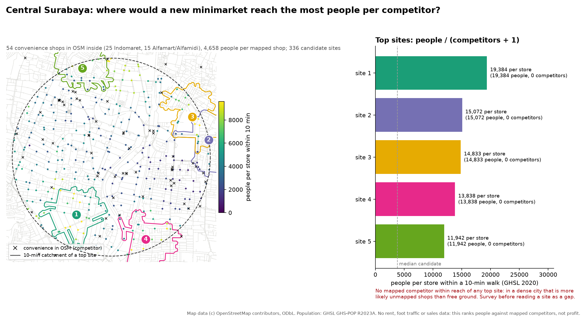
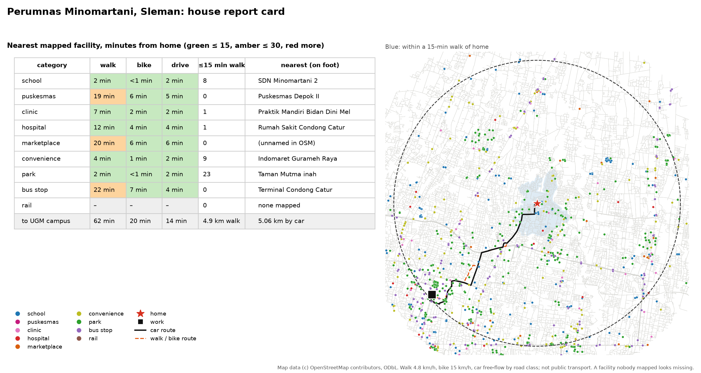
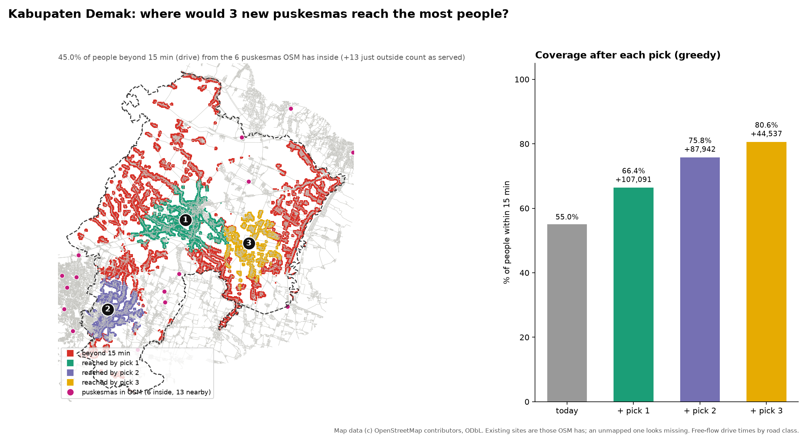
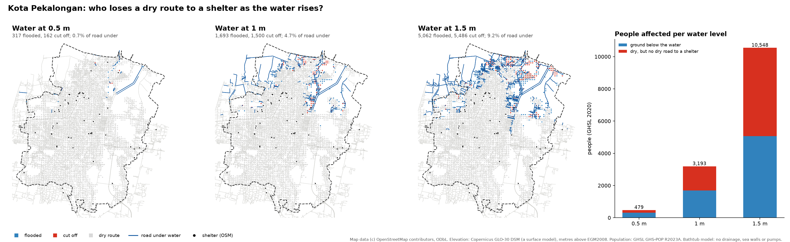
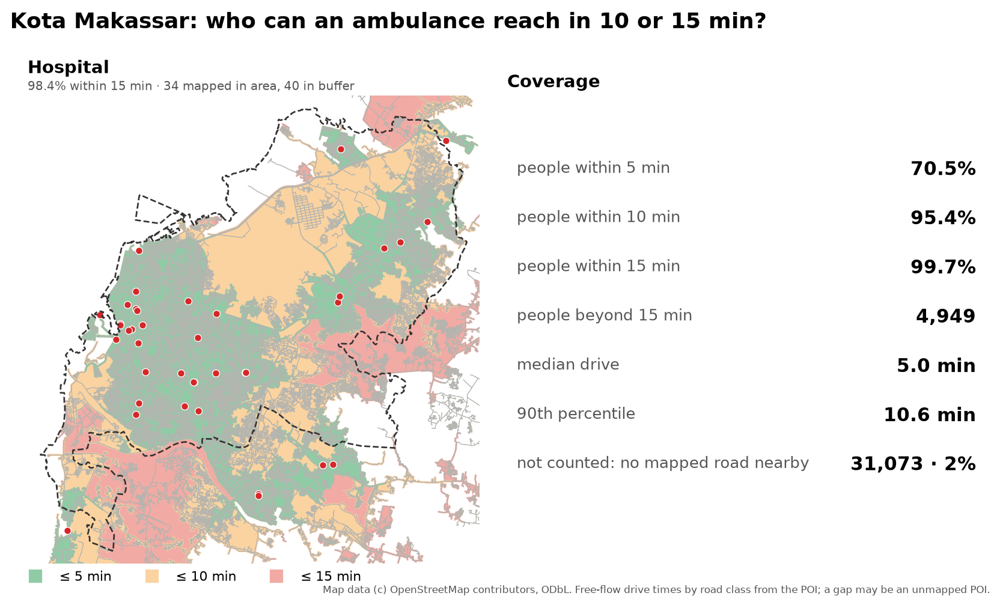
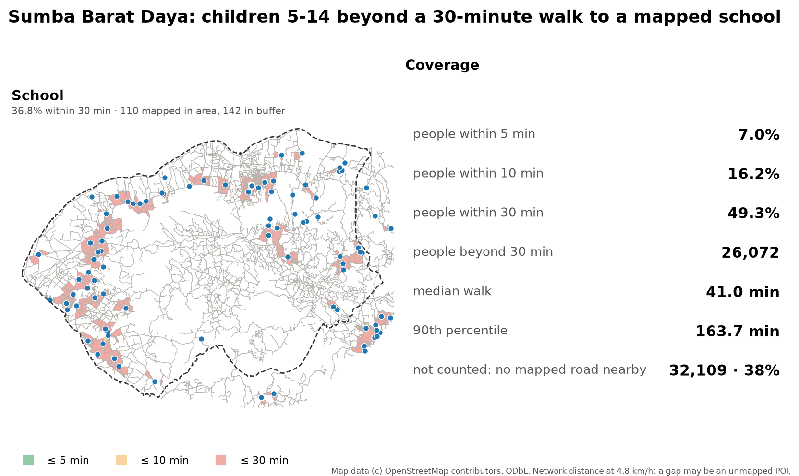

# open-urban-analysis

A skill you attach to an agent so it can answer a question about a city from free OpenStreetMap data (the same pattern as [open-satellite-analysis](https://github.com/dzakybd/open-satellite-analysis)). Give an address or coordinates and a question ("where should a new minimarket go?", "who is cut off from a shelter if the water rises 1.5 m?", "where should the next three puskesmas go?", "how far is everything from this house?"). The skill builds the street graph and POIs with [OSMnx](https://github.com/gboeing/osmnx), computes every route, isochrone and metric with NetworkX, GeoPandas and momepy, and writes numbers, a Folium map and a figure. No account and no API key.



Two versions:

1. **A skill for coding agents** (Claude Code, Codex and others that load `SKILL.md` skills): `npx skills add dzakybd/open-urban-analysis`
2. **A LangChain Deep Agents version** you can run in your own agent workflow (`agent/run.py`)

See all six cases, no install needed: [huggingface.co/spaces/dzakybd/open-urban-analysis](https://huggingface.co/spaces/dzakybd/open-urban-analysis).

## The six cases, and how far each can be checked

| # | Case | Place | Question | Headline result | What it can be checked against |
|---|---|---|---|---|---|
| 1 | Store finder (`store.py`) | Central Surabaya (Tegalsari, Genteng, Gubeng), 2 km disc | Where would a new minimarket reach the most people per mapped competitor? | OSM maps 54 minimarkets for 251,522 residents; the top five sites have no mapped competitor, the best reaches 19,384 people in 10 min | Nothing independent: no public register of minimarkets. The five empty sites are more likely unmapped shops than free ground |
| 2 | House report card (`report.py`) | Perumnas Minomartani, Sleman, 4 km disc | How far is everything from this house? | School 2.3 min and a convenience store 4.0 min on foot, puskesmas 19.1 min, market 20.0 min; UGM is 62 min on foot, 20 by bike, 14 by car (free-flow) | Nothing independent: each row is what OSM records |
| 3 | Facility siting (`siting.py`, with `accessibility.py` and `poi_coverage.py`) | Kabupaten Demak, whole regency | Where would the next three puskesmas reach the most people? | 45.0% of residents on the road network are beyond a 15-min drive of a mapped puskesmas; three greedy picks lift the share within 15 min from 55.0% to 80.6%. OSM has 5 of the 27 official puskesmas, so the first picks land where unmapped ones stand | BPS Kabupaten Demak Dalam Angka 2025 (27 puskesmas, 6 hospitals); the check mostly measures the map |
| 4 | Flood and evacuation (`flood.py`) | Kota Pekalongan, whole city | Who is flooded, or dry but cut off from every shelter, as the water rises? | At 1.5 m above the geoid: 5,062 people on flooded ground and 5,486 more dry but cut off (4.6% of 229,246). A bathtub model on a 30 m surface DEM, so a floor, not a forecast | Press reports of the tidal floods (rob); no gauge or flood-extent record to score against |
| 5 | Ambulance coverage (`accessibility.py --from-poi`) | Kota Makassar, mainland | Who can an ambulance reach from the nearest hospital in 5, 10 or 15 min? | 95.4% of people within 10 min and 99.7% within 15 min, free-flow | No public hospital count could be read, so no completeness figure; free-flow, not traffic |
| 6 | Underserved by age (`accessibility.py --population worldpop --age`) | Kabupaten Sumba Barat Daya, whole regency | Which children 5-14 and people 60+ are beyond a 30-min walk or drive of a school or health facility? | 31.2% of children 5-14 (26,072) beyond a 30-min walk of a mapped school; 8.5% of people 60+ beyond a 30-min drive of a puskesmas or hospital; 38.4% of children live more than 200 m from any mapped way | Kemendikdasmen/Dapodik table: 432 SD and SMP, OSM has 110. A floor on what is mapped, not a count of who lacks a school |

The Demak case is checked against Statistics Indonesia's (BPS) published facility and population counts, and the check mostly measures the map. The Sumba schools are checked against the Dapodik-derived table, and again the map is what falls short. The flood case has only press reports of the tidal floods, a pattern match and not a measured depth. The other cases have no independent source: they are what OSM itself records, and each section says where a check is missing or impossible.

## What it adds over a plain OSMnx query

OSMnx already downloads graphs and POIs. This skill covers the steps around it, where agents tend to go wrong:

- **Network distance, not straight-line circles.** Rivers, rail corridors and toll roads are barriers: `poi_coverage.py` reports the share of the area reached along the streets next to the share a plain circle of the same reach would claim (`runs/demak/coverage`).
- **One-way streets counted the right way round.** Accessibility runs the Dijkstra on the reversed graph (travel time *to* the POI), so one-way segments and turn restrictions do not fake symmetry. `--from-poi` times the trip *out of* the facility (an ambulance) on the forward graph.
- **Reproducible downloads.** Set `OUA_PBF` to a dated [Geofabrik](https://download.geofabrik.de) extract and the graph and POIs are clipped out of it with `osmium` — no shared Overpass server, no drift between runs (see "Dated extract or live Overpass").
- **POIs are entered from their outline.** Parks and hospital campuses are reached from points along their perimeter, not from a centroid across a fence.
- **Weighted by who lives there, optionally.** `--population` adds GHSL GHS-POP 100 m counts to every coverage number; `--population worldpop --age 5-14` weights by one age group.
- **Reported as shares of all people.** Where OSM has few roads, people far from any mapped way are counted neither reached nor beyond, and the scripts say how many.
- **No score.** The report card and the walkability comparison print transparent numbers side by side. A single score would hide which assumption decided the ranking.
- **The tag is not the thing.** Every case states what OSM's tags can and cannot say (see Limits).

## Install the skill

```bash
npx skills add dzakybd/open-urban-analysis
```

Or copy `skills/open-urban-analysis/` into your harness's skills folder. The scripts run with `uv run` and install their own dependencies (OSMnx, GeoPandas, NetworkX, momepy, folium, matplotlib; `osmium-tool` for the offline backend, `rasterio` for population weighting and the flood DEM).

## The pipeline

| Step | Script | Output |
|---|---|---|
| 1. Pin the place | `locate.py` (Nominatim, or `--lat/--lng`, or `--boundary`) | `aoi.json` |
| 2. Street network | `network_stats.py` | street length/density, intersection density, dead ends, circuity, meshedness, gamma; `streets.geojson` |
| 3. Travel-time access | `accessibility.py` | per-category % within 5/10/15 min, isochrones, cells beyond the limit; optional GHSL or WorldPop age-group population; `--from-poi` for the trip out of a facility; `isochrones.geojson` |
| 4. POI coverage | `poi_coverage.py` | counts and density per km², network vs straight-line reach |
| 5. Compare places | `walkability.py` | ten side-by-side metrics on equal discs, no score |
| 6. Closure simulation | `closure.py` | detours for random and named trips, `--landmark` check against an announced diversion, cells losing access |
| 7. Facility siting | `siting.py` | people beyond a travel-time limit, K new sites by greedy maximum coverage, people each one adds; `picks.geojson`, `unserved.geojson` |
| 8. Store finder | `store.py` | people within a walk of each candidate site per mapped competitor, top K sites; `sites.geojson`, `candidates.geojson` |
| 9. Flood and evacuation | `flood.py` | people flooded and cut off from a dry shelter route at each water level, by village; `cells.geojson`, `flooded_roads.geojson` |
| 10. House report card | `report.py` | per category minutes on foot, by bike and by car, and the commute; `pois.geojson`, `routes.geojson` |
| 11. Share a result | every script | `metrics.json` (with its data `sources`), `map.html` (Folium), `figure.png` (matplotlib) |

Steps 2, 5 and 6 are capabilities of the skill that the six showcase cases do not use; they are documented in `SKILL.md`. `locate.py --boundary` takes a GeoJSON polygon instead of a disc, for a whole regency or city (cases 3 to 6 cut the OSM admin relation out of the extract with `osmium`). `cases.sh` runs the six showcase cases end to end; each step is skipped when its `metrics.json` exists, so reruns read the cache. The offline backend caches `osmium` extracts in `~/.cache/open-urban-analysis` (the Overpass backend caches responses there too; `OUA_CACHE` moves both).

## The cases

### 1. Where to put a new store: central Surabaya

`runs/surabaya/store/` — a 2 km disc around Tegalsari, Genteng and Gubeng (12.6 km², 251,522 residents, GHSL 2020), walking at 4.8 km/h, a 10-minute catchment. `store.py` scores each of the 336 candidate street nodes (one per 200 m square) by the people who can walk to it in 10 minutes divided by the minimarkets OSM has in that catchment plus one, and keeps the top five at least 500 m apart.

OSM has 54 `shop=convenience` points inside the disc (81 with the 1.5 km buffer): 25 Indomaret, 15 Alfamart or Alfamidi and 14 others, or 4,658 residents per mapped shop. The median candidate reaches 3,840 people per store, the 90th percentile 8,432, and 5.1% of candidates have no mapped competitor.

| Rank | Location | People within 10 min | Mapped competitors | People per store |
|---|---|---|---|---|
| 1 | -7.28056, 112.73865 | 19,384 | 0 | 19,384 |
| 2 | -7.26680, 112.76280 | 15,072 | 0 | 15,072 |
| 3 | -7.26262, 112.75981 | 14,833 | 0 | 14,833 |
| 4 | -7.28500, 112.75138 | 13,838 | 0 | 13,838 |
| 5 | -7.25378, 112.73968 | 11,942 | 0 | 11,942 |


**The check is the map.** No public register of minimarkets exists to count against, so there is no official figure to compare: the only evidence is that all five top sites have no mapped competitor within a 10-minute walk, in a district of about 20,000 residents per km². That is far more likely unmapped Indomaret and Alfamart branches than free ground, and an unmapped competitor makes a site look emptier than it is. Sites 2, 3 and 5 sit on the rim of the disc, so part of their catchment lies in the buffer. The ranking uses people and mapped competitors only: no rent, foot traffic, income or sales data, so it is a place to survey on foot, not a forecast of profit. A shop mapped as `shop=supermarket` is not counted.

### 2. House report card: Perumnas Minomartani, Sleman

`runs/sleman/report/` — one address (Perumnas Minomartani, Ngaglik, Sleman, north of Yogyakarta), a 4 km reach, and one workplace (UGM campus). `report.py` gives, per category, the minutes to the nearest mapped facility on foot (4.8 km/h), by bike (15 km/h on the walking network) and by car (free-flow), its name, and how many are within a 15-minute walk. One row per category, never a combined score: which row matters depends on the household.

| Category | Mapped within reach | Walk | Bike | Car | Within 15 min walk | Nearest (walk) |
|---|---|---|---|---|---|---|
| School | 181 | 2.3 min | 0.7 | 1.5 | 8 | SDN Minomartani 2 |
| Puskesmas | 6 | 19.1 | 6.1 | 5.4 | 0 | Puskesmas Depok II |
| Clinic | 41 | 7.3 | 2.3 | 2.5 | 1 | Praktik Mandiri Bidan Dini Melani M. |
| Hospital | 24 | 12.2 | 3.9 | 3.6 | 1 | Rumah Sakit Condong Catur |
| Marketplace | 28 | 20.0 | 6.4 | 5.9 | 0 | (unnamed in OSM) |
| Convenience | 175 | 4.0 | 1.3 | 2.2 | 9 | Indomaret Gurameh Raya |
| Park | 378 | 1.5 | 0.5 | 1.8 | 23 | Taman Mutma inah |
| Bus stop | 174 | 21.8 | 7.0 | 4.4 | 0 | Terminal Condong Catur |
| Rail | 0 | none mapped | | | 0 | |

The commute to UGM is 3.89 km in a straight line, 4.9 km on foot (62 min), 20 min by bike and 14 min by car over 5.06 km.



**What the check can say.** Nothing here has an independent source, so each row is what OSM records. The weakest rows are the ones most likely to be a mapping gap: six puskesmas within reach, a nearest market with no name, and no rail station mapped within reach. The commute is a modelled walk, bike or free-flow car trip, not public transport, which is not in OSM as a timetable, and not a rush-hour drive. "Bus stop" is a mapped stop, not a service.

### 3. Where the next puskesmas goes: Kabupaten Demak

`runs/demak/` — the whole regency: the OSM boundary (admin relation 17241173, 996.7 km²; the official area is 995.3 km²), driving with free-flow speeds, facilities up to 5 km outside the border counted (Demak's west edge is Semarang city, its east Kudus and Grobogan). A disc would not do: one wide enough for Mranggen in the south-west and Wedung in the north-east takes in east Semarang, and the official facility and population counts are per regency. 58.1% of the 100 m cells are more than 200 m from a drivable road (fishponds, paddy and coast) and are left out; they hold 2.7% of the GHSL population (26,389 of 961,250), who are in neither count below.

| Question | OSM facilities in the regency (buffer) | Result | People beyond (GHSL) |
|---|---|---|---|
| Hospital within 30 min (`runs/demak/access-hospital`) | 6 (25) | 94.7% of the area | 18,421 (2.0%) |
| Puskesmas within 15 min (`runs/demak/access-primary`) | 6 (19) | 39.8% of the area | 420,857 (45.0%) |
| Any clinic within 15 min (same run) | 8 (197) | 38.5% of the area | 374,514 (40.1%) |

`poi_coverage.py` (`runs/demak/coverage`) counts what OSM has inside the boundary: 11 `amenity=hospital` points before the name filter, 6 puskesmas, 8 clinics, 0.01 per km² each. Its walking-time columns (median over 100 minutes) say only that a regency is not walkable end to end; the drive runs are the ones to read.

`siting.py --poi puskesmas --threshold-min 15 --k 3` (`runs/demak/siting`) picks from the candidate street nodes on classified roads (one per 500 m square):

| Pick | Location | Nearest OSM village | People newly within 15 min | Within 15 min after |
|---|---|---|---|---|
| today | | | | 55.0% |
| 1 | -6.906, 110.624 | Katonsari | 107,091 | 66.4% |
| 2 | -7.026, 110.519 | Mranggen | 87,942 | 75.8% |
| 3 | -6.938, 110.709 | Kuwu | 44,537 | 80.6% |



**Against the official counts, the result is mostly about the map.** [BPS Kabupaten Demak, *Kabupaten Demak Dalam Angka 2025*](https://demakkab.bps.go.id/en/publication/2025/02/28/aa73744a55d7df8df2e6a2f2/kabupaten-demak-dalam-angka-2025.html) (published 28 Feb 2025; Table 4.2.3, pp. 129-130, and Table 3.1.1) lists 27 puskesmas by name (15 with inpatient care, 12 without), 6 hospitals and 1,252,970 residents in 14 kecamatan for 2024; BPS takes the facility table from the regency health office. OSM has 4 of the 6 hospitals (RSUD Sunan Kalijaga, RSUD Sultan Fatah, RS Fatimah Sulhan Muhammadiyah, RSU Pelita Anugrah), so the hospital number is close to the ground, and a missing hospital could only raise it. For puskesmas it is not: of the 27 official names, OSM has 5 (Demak 2, Guntur 1, Guntur 2, Karangawen 2, Mijen 2) plus one, "Puskesmas Bilo Pundenarum", that is not on the official list; 10 of the 14 kecamatan have none mapped. Demak town and Mranggen officially have three puskesmas each (Demak 1 to 3, Mranggen 1 to 3), and OSM has only Demak 2: where the picks fall in those two towns (picks 1 and 2, nearest to Katonsari and Mranggen), they mark unmapped puskesmas, not missing ones. The useful output today is a mapping to-do list: map the 22 missing puskesmas, rerun, and only then read the picks as candidate sites. GHSL also counts fewer people than the official figure (961,250 in the regency against BPS's 1,252,970 for 2024), so every "people" number is low by about a quarter.

**Failure analysis: the tags.** `amenity=hospital` in and around Demak also holds four of the six OSM puskesmas, a clinic, a dental hospital, a maternity home and a bekam (cupping and massage) parlour; the hospital run drops them by name (`--exclude-name`), and an unnamed "medical center" point and a duplicate RSUD Sunan Kalijaga node stay in (the run counts 6 points in the regency for 4 distinct hospitals). Puskesmas are tagged `amenity=clinic`, `amenity=hospital` or `healthcare=centre`, so the `puskesmas` category matches any health tag whose name says Puskesmas, and leaves out Puskesmas Pembantu, which the official count of 27 does not include.

**What the model cannot see.** Drive times are free-flow by OSM road class, with no traffic and no motorbike shortcuts. Tidal flooding (rob) on the subsiding Sayung coast can put roads under water; the graph assumes every road is open. GHSL is a 100 m model of 2020, not a census.

### 4. Flood and evacuation: Kota Pekalongan

`runs/pekalongan/flood/` — the whole city (OSM admin relation 9686826), a low north-coast city on Java: 229,246 residents (GHSL 2020), walking network, shelters the OSM schools (39 in the city), mosques (7) and hospitals (5). `flood.py` raises the water to 0.5, 1.0 and 1.5 m above the EGM2008 geoid. A walking edge is under water when any point along it (every 30 m) is below the level (a bridge takes the height of its lower end, since the DEM under it is the river); a 100 m cell is flooded when its centre is; people who are dry but have no dry road to a dry shelter are counted as cut off. With no water, every resident has a route to a shelter (median 9.8 min, 90th percentile 18.4 min).

| Water level | Road under water | People on flooded ground | Dry but cut off | Dry route left, median min |
|---|---|---|---|---|
| 0.5 m | 0.7% | 317 (0.1%) | 162 (0.1%) | 9.7 |
| 1.0 m | 4.7% | 1,693 (0.7%) | 1,500 (0.7%) | 9.4 |
| 1.5 m | 9.2% | 5,062 (2.2%) | 5,486 (2.4%) | 9.1 |

At 1.5 m the worst villages (nearest OSM place point) are Panjang Wetan (1,103 flooded, 1,980 cut off), Panjang Baru (1,024 and 1,547), Krapyak (905 and 348), Kandang Panjang and Poncol; the affected cells in the figure cluster in the north-east of the city.



**Why a cell is cut off.** A cut-off cell is dry ground whose every road to a shelter crosses a segment that dips below the level. Every one of the 234 cut-off cells at 1.5 m lies within 196 m of a road under water (90th percentile 140 m); `metrics.json` records this distance per level.

**Against the record.** Tidal flooding (rob) in the north of Pekalongan is a repeating event: after the rob of 23 May 2018 the Pekalongan Utara sub-district head said nearly all kelurahan there were flooded, with Degayu the exception, and residents of Krapyak reported about half the area under water ([NU Online, 24 May 2018](https://nu.or.id/daerah/banjir-rob-di-pekalongan-utara-warga-nu-kesulitan-jalankan-ibadah-2t7kn)). The model's exposed groups include Krapyak and the other northern villages above, but that is a pattern match, not a measured depth: there is no gauge or flood-extent record in this run to score it against.

**What it cannot see.** The elevation is Copernicus GLO-30, a 30 m *surface* model (roofs and trees raise it), so built-up ground reads high and the flood is understated; the terrain model made for coasts, DeltaDTM ([4TU.ResearchData, doi 10.4121/21997565](https://doi.org/10.4121/21997565), CC BY 4.0), could not be downloaded from here (data.4tu.nl timed out on 1 Nov 2026), and `--dem` takes one of its tiles. Heights are above the EGM2008 geoid, not local mean sea level, and the DEM dates from 2011-2015, while this coast is sinking, so today's ground is lower than it reads. The water is a still bathtub: no tide timing, drainage, sea walls, pumps, embankments or rainfall, and no 30 m model sees a kerb. A road crossing an unmapped culvert counts as under water. Only 7 mosques are mapped for a city of this size, so the shelters are mostly schools, and a shelter nobody mapped looks absent.

### 5. Ambulance coverage: Kota Makassar

`runs/makassar/ambulance` — the city's mainland (OSM admin relation 11243159, `--mainland` drops the 13 Spermonde islands: no road reaches them, boats and island puskesmas serve them), drive times in free flow **from** the nearest hospital (`--from-poi`, the forward graph: an ambulance leaving the hospital respects one-way streets in that direction), hospitals up to 5 km outside the border counted, GHSL population. OSM snapshot of the Geofabrik Sulawesi extract, 30 Oct 2026.

| | Within 5 min | Within 10 min | Within 15 min | Beyond 15 min |
|---|---|---|---|---|
| Area | 50.5% | 87.5% | 98.4% | 1.6% |
| People (GHSL) | 70.5% | 95.4% | 99.7% | 0.3% (4,949) |

Median 5.0 min, 90th percentile 10.6 min; 34 hospital features in the city, 40 with the buffer (`metrics.json`). The area share within 5 min (50.5%) sits below the people share (70.5%) because the population sits around the hospitals in the dense centre. The people shares are of the 1,556,171 people on the road network; the other 31,073 (2.0% of 1,587,244) are in neither count.



**Tags.** `amenity=hospital` in Makassar also holds pharmacies (Apotek), puskesmas, posyandu, clinics, the Public Safety Centre 119 dispatch post, maternity (bersalin, RSIA, ibu dan anak), eye, dental and psychiatric (Dadi) hospitals and unnamed features. The run drops them by name (`--exclude-name`), so what is kept are general and teaching hospitals plus a few that mappers tag only `healthcare=hospital`; I listed the dropped names to check none is a general hospital. The kept list still has duplicates (two RS Hermina, two Luramay, an "IGD" point, an "IGD RS Pelamonia") that do not change the time surface, and the unnamed features could hide a hospital. I found no public official hospital count that can be read for the city, so there is no completeness figure: OSM may lack hospitals, and a missing one only makes the result worse.

**What the model cannot see.** Free-flow speeds by road class: in traffic an ambulance reaches fewer people in 10 min, and sirens and lane clearing go the other way. GHSL is a 2020 model, not a census. 19.0% of the 100 m cells are more than 200 m from a drivable road and hold 2.0% of the people.

### 6. Who is underserved by age: Kabupaten Sumba Barat Daya

`runs/sumba-barat-daya/` — the whole regency, East Nusa Tenggara (OSM relation 11225333, 1,394 km²), on WorldPop [R2025A](https://hub.worldpop.org/geodata/listing?id=138) 2025 age groups (CC BY 4.0, 100 m, constrained, a model): children 5-14 (83,533) and people 60+ (20,107) in the regency. OSM snapshot of the Geofabrik Nusa Tenggara extract, 30 Oct 2026.

**Read this first.** OSM here has a fraction of the facilities, and the roads are patchy too: 75.9% of the 100 m cells on foot and 79.6% by car (38.4% of children on foot, 43.1% of the 60+ by car, 38.4% of the 60+ on foot) are more than 200 m from any mapped way and are counted neither as served nor as beyond reach. Unmapped schools and health posts look like gaps. The figures below are a floor on what is mapped, not a count of who lacks a school.

| Run (`runs/sumba-barat-daya/...`) | Facilities in OSM (regency, with buffer) | Reached on the mapped network | Beyond limit | Not on the mapped network |
|---|---|---|---|---|
| `school-walk`: children 5-14, 30 min walk, primary or junior school | 110 (142) | 30.3% of all children | 26,072 (31.2%) | 32,109 (38.4%) |
| `health-drive`: people 60+, 30 min drive, puskesmas or hospital | 6 (9) | 48.4% of all 60+ | 1,701 (8.5%) | 8,675 (43.1%) |
| `health-walk`: people 60+, 30 min walk, any health post (pustu, polindes, puskesdes too) | 28 (37) | 19.9% of all 60+ | 8,371 (41.6%) | 7,731 (38.4%) |

The shares of all people are my arithmetic from `metrics.json` (`population.total_in_area`, `total_on_network`, `beyond_limit_population`); the file itself gives shares of the people on the network (children beyond a school: 50.7%; 60+ beyond the drive: 14.9%; beyond the walk: 67.6%).

`school-walk-named` is the sensitivity run: the same question keeping only schools that have a name in OSM (78 instead of 110, because 32 `amenity=school` features are unnamed and may be buildings or schools the name filter did not catch). It lowers the people within 30 min from 49.3% to 42.0% of those on the network; the true figure sits between, and both rest on the same incomplete map.



**Against a national register.** Kemendikdasmen's Dapodik-derived table lists 288 SD and 144 SMP (432 with their MI and MTs equivalents) in Kabupaten Sumba Barat Daya ([referensi.data.kemendikdasmen.go.id](https://referensi.data.kemendikdasmen.go.id/pendidikan/dikdas/241900/2/all/all/all), read 1 Nov 2026). OSM has 110 in the regency, about a quarter; the other three quarters are unmapped or unnamed, so many children close to a school look far from one. For puskesmas I found no public count I could check, so the 9 OSM points in and around the regency (four puskesmas, Bondokodi mapped twice; the Karitas hospital twice; RSUD Waikabubak twice) carry no completeness figure: OSM almost certainly lacks some.

Dropped by name: SMA, SMK, MA, kindergarten and PAUD, dormitories and libraries from the school run; posyandu (a monthly session, not a facility), pustu, polindes and unnamed points from the drive run.

## Data sources

All data is free and public. Each run's `metrics.json` lists the sources it read in its `sources` field; the table is built from those and from the validation sources named in the cases.

| Source | What it gives | Version / date | Licence | Cases |
|---|---|---|---|---|
| [OpenStreetMap](https://www.openstreetmap.org/copyright) via [Geofabrik](https://download.geofabrik.de/asia/indonesia.html) extracts | Street network, facilities (hospital, clinic, school, shop, mosque, bus stop...), admin boundaries | Java 27 Oct 2026; Sulawesi and Nusa Tenggara 30 Oct 2026 (snapshots, not live) | ODbL 1.0, (c) OpenStreetMap contributors | 1 to 6 (Java: 1 to 4; Sulawesi: 5; Nusa Tenggara: 6) |
| [GHSL GHS-POP](https://ghsl.jrc.ec.europa.eu/ghs_pop.php) (JRC) | People per 100 m cell, all ages, a model | R2023A, 2020 epoch | CC BY 4.0 | 1, 3, 4, 5 |
| [WorldPop](https://hub.worldpop.org/geodata/listing?id=138) Global2 age and sex structures | People per 100 m cell by five-year age group, constrained, a model | R2025A v1, 2025 (doi 10.5258/SOTON/WP00841) | CC BY 4.0 | 6 |
| [Copernicus DEM GLO-30](https://registry.opendata.aws/copernicus-dem/) (ESA) | 30 m surface elevation, heights above the EGM2008 geoid | Public release on AWS, read 1 Nov 2026 (acquired 2011-2015) | Copernicus DEM licence: free use with attribution | 4 |
| [BPS Kabupaten Demak, *Kabupaten Demak Dalam Angka 2025*](https://demakkab.bps.go.id/en/publication/2025/02/28/aa73744a55d7df8df2e6a2f2/kabupaten-demak-dalam-angka-2025.html) | Official puskesmas, hospital and population counts (validation only) | Published 28 Feb 2025; 2024 counts | Not checked | 3 |
| [Kemendikdasmen reference data](https://referensi.data.kemendikdasmen.go.id/pendidikan/dikdas/241900/2/all/all/all) (Dapodik-derived) | Official school counts (validation only) | Read 1 Nov 2026 | Not checked | 6 |

Case 2 uses OpenStreetMap only, no population grid. The two validation-only sources are never an input to a number; they are what the OSM counts are compared with. Geocoding by name (`locate.py "<place>"`) uses OpenStreetMap [Nominatim](https://nominatim.org); the six cases are located by coordinates or by an OSM boundary instead. DeltaDTM (4TU.ResearchData, doi 10.4121/21997565, CC BY 4.0) is supported by `--dem` but was not used: the download timed out.

**Not used:** no mobility traces, transit schedules, traffic, rent, foot-traffic or sales data. Travel times are modelled from road class (walking 4.8 km/h, bike 15 km/h on the walking network, driving free-flow speeds by OSM highway type), not measured.

## Dated extract or live Overpass

The published runs read a dated Geofabrik extract through `osmium` (`OUA_PBF`), not the live Overpass API.

- **Use a dated extract** for anything published or large (a whole regency or city), and whenever the result must reproduce: the snapshot is fixed and written into `metrics.json`, there is no shared server to wait for, and a large area is a local clip instead of a heavy query. The cost is a multi-hundred-MB download per island group, once.
- **Use live Overpass** for a quick ad hoc question on a small area (a 1-2 km disc) when you do not want to download an island: it needs no setup. Overpass is a shared volunteer service that is often at capacity (it answers 502 "at capacity"), the data changes daily so two runs can differ, and a regency-sized query is unreasonable. The scripts back off, rotate mirrors and cache every response.
- The two backends agree to within a few percentage points on a disc (graph-filter differences, plus the OSM edits between the snapshot and the live API), so read any single percentage with that band. A cross-check on an earlier disc is not part of the six cases.

## Deep Agents runner (ChatGPT sign-in)

```bash
uv sync
# once: sign in with your ChatGPT account (no API key)
uv run python -c "from langchain_openai.chatgpt_oauth import login_chatgpt; login_chatgpt()"

uv run python agent/run.py runs/my-question \
  "Where in central Surabaya would a new minimarket reach the most people per mapped competitor within a 10-minute walk? Use -7.27, 112.745 with a 2 km radius."
```

The agent loads the same `SKILL.md`, runs the scripts in the work directory, and writes `answer.md` and `run.json` (time, tool calls, tokens).

## Limits of OSM data

- **A gap is not a missing facility.** The scripts measure access to POIs that OSM has. A school, clinic or market nobody mapped looks like a gap; one mapped in the wrong place looks like access. Markets and small clinics are the least complete; every answer says how many POIs were found and names them.
- **No sidewalk quality, shade, lighting, traffic speed or safety.** Mapped sidewalk share mostly measures mapper effort.
- **Walking time is network distance at 4.8 km/h.** No stairs, slope or crossing waits. Mapped barriers (rivers, rail, toll roads) are respected; unmapped ones are not.
- **Driving times are free-flow.** Trips on a busy day are longer than the minutes reported, and a missing back road in OSM makes detours look longer than they are.
- **A siting pick can be a mapping gap.** `siting.py` treats the facilities OSM has as all that exist. In Demak OSM has 5 of 27 official puskesmas, and the top picks land where unmapped ones stand: check every pick against an official list.
- **Areas are discs (or a boundary with `--boundary`) on a 100 m grid.** Cells more than 200 m from any street are dropped and reported. It is area, not people, unless `--population` is used, and the population grids are models, not censuses. In a sparsely mapped regency (Sumba Barat Daya) 38-43% of the people are beyond that 200 m and count as neither reached nor beyond.
- **The elevation is a surface model.** Copernicus GLO-30 includes roofs and trees, heights are above the geoid, and the bathtub flood ignores tide, drainage and defences: a floor, not a forecast.

## Ideas not built yet

- Terrain and DEM for other hazards: landslide susceptibility from slope, or lowland drainage and ponding beyond the coastal flood.
- Built-up growth over time from the GHSL epochs (1975 to 2030), to see where a city grew toward flood or toward a missing service.
- Network resilience for a whole area: close each bridge or junction in turn and rank which ones cut the most people off, instead of one named closure.
- Street-pattern morphology: classify grids, cul-de-sac clusters and organic fabric from the street graph and compare neighbourhoods with it.

## Licences

Code: MIT. Data licences are in the Data sources table above.

## Built on

- [OSMnx](https://github.com/gboeing/osmnx), [NetworkX](https://networkx.org), [GeoPandas](https://geopandas.org), [momepy](https://github.com/urbangrammarai/momepy), [folium](https://github.com/python-visualization/folium), matplotlib.
- [osmium-tool](https://osmcode.org/osmium-tool/) for clipping the offline extracts.
- Copernicus GHSL population grid (European Commission, JRC), WorldPop (University of Southampton), Copernicus DEM (ESA).
- [LangChain Deep Agents](https://docs.langchain.com/oss/python/deepagents/overview) and the [skills CLI](https://github.com/vercel-labs/skills).

## Space

The static showcase under `space/` is packed from the runs by:

```bash
uv run python space/build.py
```

which reads every number from the runs' own `metrics.json` into `space/data/`, then upload the folder to a Hugging Face static Space (`create_repo(repo_type="space", space_sdk="static")`, then `upload_folder`). The published Space: [huggingface.co/spaces/dzakybd/open-urban-analysis](https://huggingface.co/spaces/dzakybd/open-urban-analysis).
