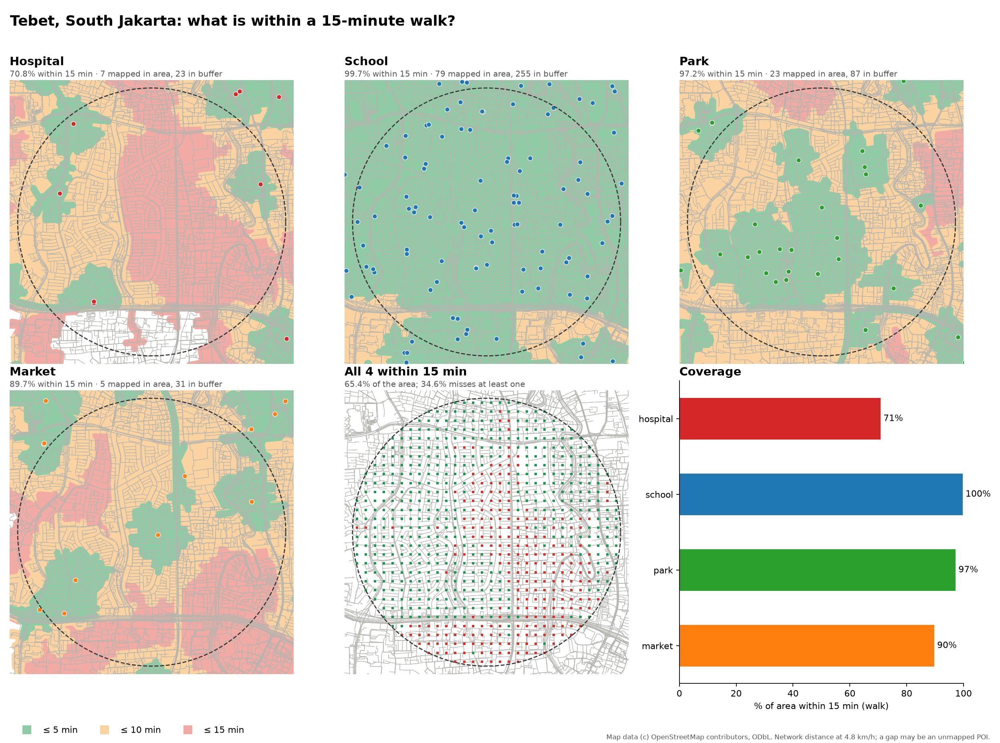
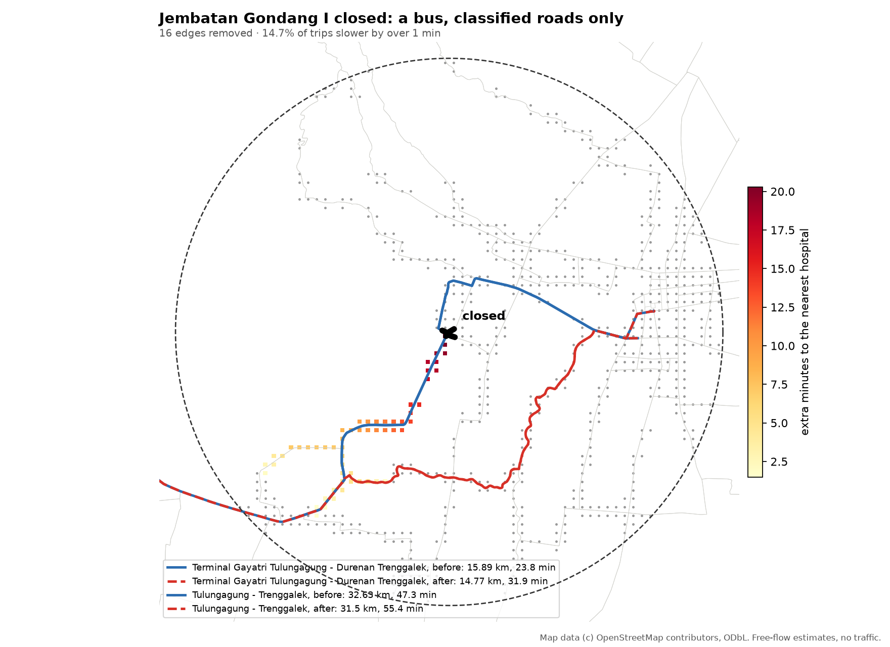
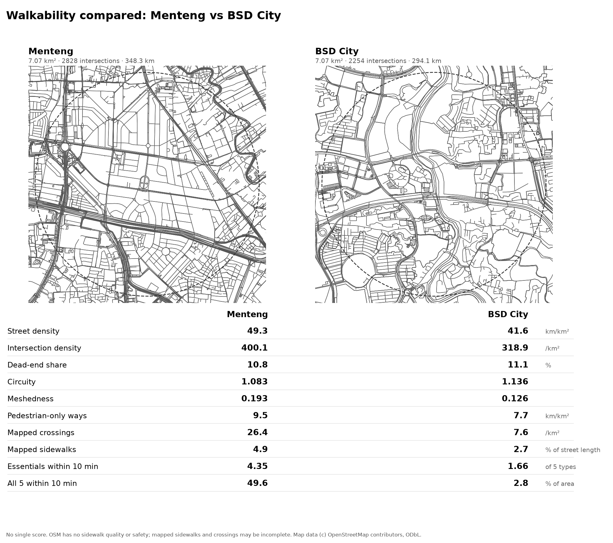
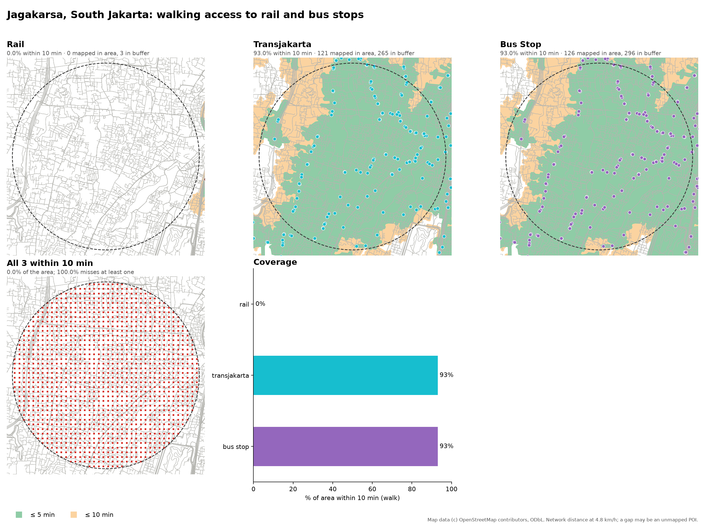
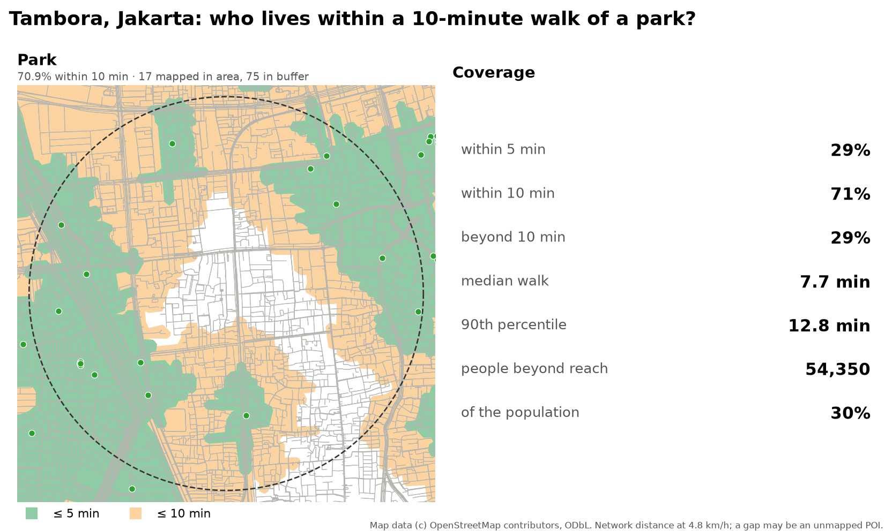
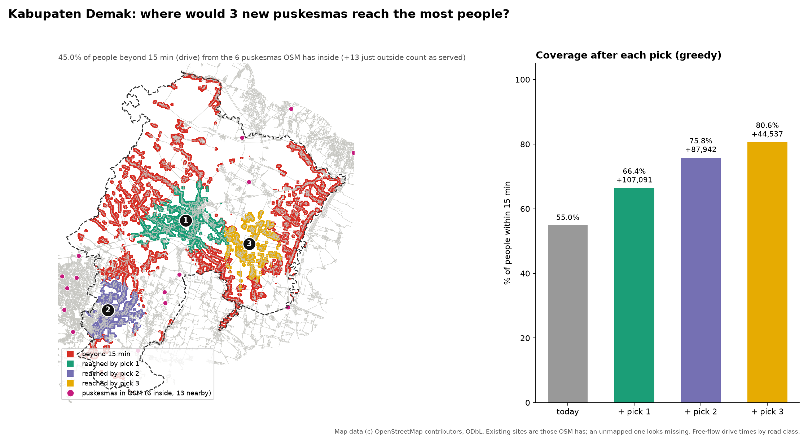

# open-urban-analysis

A skill you attach to an agent so it can answer a question about a city from free OpenStreetMap data (the same pattern as [open-satellite-analysis](https://github.com/dzakybd/open-satellite-analysis)). Give an address or coordinates and a question ("what share of this district is within a 15-minute walk of a hospital, school, park and market?", "what happens if this bridge closes?", "is this neighbourhood walkable?", "where should the next three puskesmas go?"). The skill builds the street graph and POIs with [OSMnx](https://github.com/gboeing/osmnx), computes every route, isochrone and metric with NetworkX, GeoPandas and momepy, and writes numbers, a Folium map and a figure. No account and no API key.



Two versions:

1. **A skill for coding agents** (Claude Code, Codex and others that load `SKILL.md` skills): `npx skills add dzakybd/open-urban-analysis`
2. **A LangChain Deep Agents version** you can run in your own agent workflow (`agent/run.py`)

See all six cases, no install needed: [huggingface.co/spaces/dzakybd/open-urban-analysis](https://huggingface.co/spaces/dzakybd/open-urban-analysis).

## Six cases, and how far each can be checked

| Question | Place | Scripts | Result |
|---|---|---|---|
| Who is within a 15-minute walk of a hospital, school, park and market? | Tebet, South Jakarta, 1.5 km disc | `accessibility.py`, `network_stats.py`, `poi_coverage.py` | 65.4% of the area reaches all four; 44,245 residents (35.2%) miss at least one. Hospital is the binding gap: 70.8% |
| What if the bridge closes? | Jembatan Gondang I, Tulungagung–Trenggalek national road, closed 2 Jun 2026 | `closure.py` | Car: 20.5% of trips slower, median +3.6 min. Bus on classified roads: median +8.6 min, worst +37 min; the detour follows the announced southern corridor but is 1.1 km shorter, because the disc cannot hold the announced 10 km loop |
| Which neighbourhood is more walkable? | Menteng (1920s) vs BSD City (2000s), equal 1.5 km discs | `walkability.py` | Menteng: 400 intersections/km², 4.35 of 5 essentials within 10 min. BSD: 319/km², 1.66. No single score, on purpose |
| Is this a transit desert? | Jagakarsa vs Dukuh Atas (benchmark), 2 km discs | `accessibility.py` | Rail within 10 min: 0% vs 34.8%. TransJakarta-tagged stops (mostly Mikrotrans feeders): 93% vs 95% |
| Who lives beyond a 10-minute walk of a park? | Tambora, West Jakarta, 1.5 km disc | `accessibility.py --population` | 70.9% within 10 min; 54,350 people (30.0%) beyond it |
| Where would three new puskesmas reach the most people? | Kabupaten Demak, Central Java, the whole regency (OSM boundary) | `accessibility.py --mode drive`, `poi_coverage.py`, `siting.py` | 2.0% of residents beyond a 30-min drive of a hospital, 45.0% beyond 15 min of a mapped puskesmas; three greedy picks lift 55.0% to 80.6%. But OSM has 5 of the 27 official puskesmas, and the first two picks land where unmapped ones stand |

The closure has an independent source: news reports of the announced diversion (detik, Kompas, Antara, links below). The Demak case is checked against the regency health office's facility and population counts, and the check mostly measures the map. The Tebet case is checked against the other OSM backend (live Overpass against the dated extract) and the transit case against TransJakarta's published corridor map, partially; Menteng–BSD and Tambora have no independent source. Those two are what OSM itself records, and each section says where a check is missing or impossible.

## What it adds over a plain OSMnx query

OSMnx already downloads graphs and POIs. This skill covers the steps around it, where agents tend to go wrong:

- **Network distance, not straight-line circles.** A 1,200 m circle around a rail station claims 91% of Tebet; along the streets it is 48% (`runs/tebet/coverage`), because rivers, rail corridors and the toll road are barriers.
- **One-way streets counted the right way round.** Accessibility runs the Dijkstra on the reversed graph (travel time *to* the POI), so one-way segments and turn restrictions do not fake symmetry.
- **Reproducible downloads.** Set `OUA_PBF` to a dated [Geofabrik](https://download.geofabrik.de) extract and the graph and POIs are clipped out of it with `osmium` — no shared Overpass server, no drift between runs. The published runs use `java-latest.osm.pbf` of 27 Oct 2026.
- **A bridge is not an edge.** OSM draws many bridges as `man_made=bridge` polygons with the road untagged underneath, and side alleys bypass a single-span closure. The closure script closes a radius, checks the removed edges, and verifies named routes actually change (`--landmark` distances against the announced diversion).
- **POIs are entered from their outline.** Parks and hospital campuses are reached from points along their perimeter, not from a centroid across a fence.
- **Weighted by who lives there, optionally.** `--population` adds GHSL GHS-POP 100 m counts to every coverage number: 35.2% of Tebet's residents, not 34.6% of its cells.
- **No walkability score.** The comparison script prints ten transparent metrics side by side. A single score would hide which assumption decided the ranking.
- **The tag is not the thing.** Every case states what OSM's tags can and cannot say (see Limits).

## Install the skill

```bash
npx skills add dzakybd/open-urban-analysis
```

Or copy `skills/open-urban-analysis/` into your harness's skills folder. The scripts run with `uv run` and install their own dependencies (OSMnx, GeoPandas, NetworkX, momepy, folium, matplotlib; `osmium-tool` and `rasterio` only for the offline backend and population weighting).

## The pipeline

| Step | Script | Output |
|---|---|---|
| 1. Pin the place | `locate.py` (Nominatim, or `--lat/--lng`) | `aoi.json` |
| 2. Street network | `network_stats.py` | street length/density, intersection density, dead ends, circuity, meshedness, gamma; `streets.geojson` |
| 3. Walking (or driving) access | `accessibility.py` | per-category % within 5/10/15 min, isochrones, cells beyond the limit, optional GHSL population; `isochrones.geojson` |
| 4. POI coverage | `poi_coverage.py` | counts and density per km², network vs straight-line reach |
| 5. Compare places | `walkability.py` | ten side-by-side metrics on equal discs, no score |
| 6. Closure simulation | `closure.py` | detours for random and named trips, `--landmark` check against the announced diversion, cells losing access |
| 7. Facility siting | `siting.py` | people beyond a travel-time limit, K new sites by greedy maximum coverage, people each one adds; `picks.geojson`, `unserved.geojson` |
| 8. Share a result | every script | `metrics.json`, `map.html` (Folium), `figure.png` (matplotlib) |

`locate.py --boundary` takes a GeoJSON polygon instead of a disc, for a whole regency (case 6 cuts the OSM admin relation out of the extract with `osmium`). `cases.sh` runs the six showcase cases end to end; each step is skipped when its `metrics.json` exists, so reruns read the cache. The Overpass backend caches responses in `~/.cache/open-urban-analysis`; the offline backend caches `osmium` extracts there too (`OUA_CACHE` moves both).

## The cases

### 1. The 15-minute city: Tebet, South Jakarta

`runs/tebet/` — a 1.5 km disc, 7.07 km², 125,859 residents (GHSL 2020), walking at 4.8 km/h, 15-minute limit.

| Category | POIs mapped in area | ≤ 15 min | Median walk | People beyond |
|---|---|---|---|---|
| Hospital | 7 | 70.8% | 11.5 min | 37,258 |
| School | 79 | 99.7% | 3.1 min | 334 |
| Park | 23 | 97.2% | 7.3 min | 4,543 |
| Market | 5 | 89.7% | 9.2 min | 13,203 |

65.4% of the area reaches all four within 15 minutes; 0.1% reaches none. The hospital figure is the honest one *after* a fix: one dental clinic ("Ocean Dental Tebet") is tagged `amenity=hospital` in OSM, and counting it lifts coverage to 80.4% (`runs/tebet/access-raw` is the run without the exclusion, kept as the sensitivity check).


`network_stats.py` on the same disc: 409.8 km of streets (58.0 km/km²), 532.6 intersections/km², 11.9% dead ends, circuity 1.093, meshedness 0.186. `poi_coverage.py`: 231 mapped POIs in 7 categories; the rail gap is the starkest straight-line overstatement (48% network vs 91% circle).

**Backend check.** `runs/tebet/access-overpass-check` is the same run against the live Overpass API instead of the dated PBF: identical POI counts, all-category coverage 61.6% vs 65.4%. The two graph builders disagree on a few short links (foot-access and service-street filtering), and Overpass is two days of edits ahead of the snapshot; read any single percentage with a ±4 pp band.

### 2. Bridge closure: Jembatan Gondang I

`runs/gondang/` — the bridge on the Tulungagung–Trenggalek national road (Desa Bendungan, Kecamatan Gondang) closed for rebuilding on 2 June 2026, announced until 11 December. Two simulations on the 8 km drive network around it, with the same closure (`--close-near=-8.0717,111.84665,150`: every road edge within 150 m — the OSM way is a `man_made=bridge` polygon with alley bridges beside it, so a tighter radius gets bypassed).

| Scenario | Trips slower > 1 min | Median extra | p90 | Max | Cut off |
|---|---|---|---|---|---|
| Car, every OSM road | 20.5% | +3.6 min | +4.0 min | +8.2 min | 0% |
| Bus, trunk/primary/secondary/tertiary only (`--classes`) | 14.7% | +8.6 min | +16.0 min | +37.2 min | 1.6% |

Named routes (Terminal Gayatri Tulungagung → Durenan, Trenggalek; Tulungagung → Trenggalek) gain 3.6–3.7 min by car and 8.1 min by bus. The bus detour swings 3.4–3.6 km away from the bridge and 1.0 km closer to Campurdarat: it runs south through the Campurdarat–Pakel loop.

**Against the announced diversion.** The police sent light vehicles through the small lanes around Mojoarum–Kalangbret and heavy vehicles (buses, six-wheel trucks) south via Simpang Tamanan–Campurdarat–Pakel–Bandung, about 10 km longer ([detik, 2 Jun 2026](https://www.detik.com/jatim/berita/d-8514918/jembatan-gondang-ditutup-total-6-bulan-ini-jalur-alternatifnya); [Antara, 2 Jun 2026](https://www.antaranews.com/berita/5591581/jalan-nasional-tulungagung-trenggalek-ditutup-total); [Kompas, 2 Jun 2026](https://surabaya.kompas.com/read/2026/06/02/220053378/jembatan-gondang-tulungagung-ditutup-hingga-desember-2026-ini-jalur); [Kompas on the bus rerouting, 9 Jun 2026](https://surabaya.kompas.com/read/2026/06/09/151706378/jalur-dialihkan-akibat-proyek-jembatan-gondang-tarif-bus-trenggalek)). The model matches the announced split in direction without being told which roads are which: the car detour uses the same small lanes north of the river, and on classified roads only it swings south through the same Campurdarat corridor. **It does not match the announced detour's length, and the check cannot:** the model's bus detour is 1.1 km *shorter* than the direct run (14.8 vs 15.9 km, +8.1 min on slower roads), while the announced heavy route adds about 10 km. The named origin-destination pairs end inside the 8 km analysis disc, so a trip leaves the disc long before it has traced the full announced loop; the comparison validates the corridor, not the distance. Part of the gap may also be real: the police chose the long loop for road width, which OSM's free-flow model does not see. The bridge reopened to traffic on 24 Oct 2026 while finishing works continue ([Antara Jatim](https://jatim.antaranews.com/berita/1110811/jembatan-gondang-tulungagung-dibuka-untuk-umum)) — the simulation describes the closure period.



**Failure cases that shaped the tool.** `--bridge-only` within 80 m removed four minor streets and changed no route (the road under the bridge polygon is untagged, so nothing matched the real span). Closing only the trunk road within 30 m was bypassed through the alley bridges within metres. Both are why the script closes a radius and prints the removed edges and `--landmark` distances for verification.

### 3. Walkability compared: Menteng vs BSD City

`runs/walkability/` — equal 1.5 km discs, one metric table, no score.

| Metric | Menteng | BSD City |
|---|---|---|
| Street density | 49.3 km/km² | 41.6 km/km² |
| Intersection density | 400.1 /km² | 318.9 /km² |
| Dead-end share | 10.8% | 11.1% |
| Circuity | 1.083 | 1.136 |
| Meshedness | 0.193 | 0.126 |
| Pedestrian-only ways | 9.5 km/km² | 7.7 km/km² |
| Mapped crossings | 26.4 /km² | 7.6 /km² |
| Mapped sidewalks | 4.9% of length | 2.7% |
| Essentials within 10 min | 4.35 of 5 | 1.66 of 5 |
| All 5 within 10 min | 49.6% | 2.8% |



The maps show why: Menteng is a fine-grained grid with schools and markets inside the blocks; BSD is cul-de-sac clusters feeding arterial loops, with big plotted blocks still undeveloped inside the disc. **What the check cannot say:** the sidewalk and crossing numbers measure mapper effort as much as pavement — Jakarta is far better mapped than a 2000s new town — and OSM records nothing about shade, width, traffic speed or safety. The essentials gap (4.35 vs 1.66) is the metric least affected by mapping effort, and it agrees with the street pattern.

### 4. Transit access: Jagakarsa vs Dukuh Atas

`runs/transit/` and `runs/transit-benchmark/` — equal 2 km discs, 10-minute walk limit, stops = OSM rail stations, stops tagged TransJakarta, and all bus stops.

| | Jagakarsa | Dukuh Atas (benchmark) |
|---|---|---|
| Rail | 0% (0 stops mapped) | 34.8% (10 stops, median 12.4 min) |
| TransJakarta-tagged stops | 93% (121) | 95.1% (185) |
| Any bus stop | 93% (126) | 95.6% (197) |



The pairing makes the tags visible: Jagakarsa has no rail in OSM and 93% "TransJakarta" coverage because **Mikrotrans feeder vans are tagged `network=TransJakarta`** — the category matches the network tag, so it measures the minibus feeder web, not BRT corridors. The desert is real but specific: no rapid transit within a 10-minute walk, while feeder stops are dense. The benchmark disc shows what the same measure reads at the city's main hub — and how high the bar is: even around Dukuh Atas, where four rail lines and the BRT corridors meet, only 34.8% of the disc is within a 10-minute walk of a rail stop, because a 2 km disc is big and stations are few. Cross-checked against [TransJakarta's published corridor map](https://transjakarta.co.id/peta-rute/) for the corridors — the feeder-stop counts are OSM-only and not independently checked.

### 5. Green space with population: Tambora

`runs/green/` — 1.5 km disc, 10-minute walk, parks weighted by the GHSL population grid.

Tambora packs about 181,000 people (GHSL 2020) into the 7.07 km² disc — roughly 25,600 per km², among the densest ground in Jakarta — and its mapped parks are small pocket greens clustered toward the disc's edge. 70.9% of the area is within a 10-minute walk of one; the 29.1% beyond is the white core on the figure, and it is where most of the people are: **54,350 residents (30.0%)** live farther than a 10-minute walk from any mapped park. Median walk 7.7 min, 90th percentile 12.8 min. Parks are entered from points along their outline, so a fenced or gated green counts where its gate is. No independent ground truth exists for park access here; the number is what OSM records, and small neighbourhood fields and RT-level open spaces are exactly what mappers most often leave out.



### 6. Facility siting for a regency: Kabupaten Demak

`runs/demak/` — the whole regency: the OSM boundary (admin relation 17241173, 996.7 km²; the official area is 995.3 km²), driving with free-flow speeds, facilities up to 5 km outside the border counted (Demak's west edge is Semarang city, its east Kudus and Grobogan). A disc would not do: one wide enough for Mranggen in the south-west and Wedung in the north-east takes in east Semarang, and the official facility and population counts are per regency. 58.1% of the 100 m cells are more than 200 m from a drivable road (fishponds, paddy and coast) and are left out; they hold 2.7% of the GHSL population.

| Question | OSM facilities in the regency (buffer) | Result | People beyond (GHSL) |
|---|---|---|---|
| Hospital within 30 min (`runs/demak/access-hospital`) | 4 distinct hospitals (25 points with the buffer) | 94.7% of the area, median 16.9 min | 18,421 (2.0%) |
| Puskesmas within 15 min (`runs/demak/access-primary`) | 6 (19) | 39.8% of the area, median 16.9 min | 420,857 (45.0%) |
| Any clinic within 15 min (same run) | 8 (197) | 38.5% | 374,514 (40.1%) |

`poi_coverage.py` (`runs/demak/coverage`) counts what OSM has inside the boundary: 11 `amenity=hospital` points before the name filter, 6 puskesmas, 8 clinics, 0.01 per km² each. Its walking-time columns (median over 100 minutes) say only that a regency is not walkable end to end; the drive runs are the ones to read.

`siting.py --poi puskesmas --threshold-min 15 --k 3` (`runs/demak/siting`) picks from 752 candidate street nodes on classified roads:

| Pick | Location | Nearest OSM village | People newly within 15 min | Within 15 min after |
|---|---|---|---|---|
| today | | | | 55.0% |
| 1 | -6.90631, 110.62352 | Katonsari (Demak town) | 107,091 | 66.4% |
| 2 | -7.02641, 110.51893 | Mranggen | 87,942 | 75.8% |
| 3 | -6.93774, 110.70875 | Kuwu, east of Demak town | 44,537 | 80.6% |



**Against the official counts, the result is mostly about the map.** The regency health office lists 27 puskesmas (15 with inpatient beds, 12 outpatient), 52 puskesmas pembantu, 6 hospitals (2 regional, 4 private) and 1,259,682 residents in 14 kecamatan in the first half of 2025 ([Dinkes Kabupaten Demak, Bahan LPPD 2025](https://dinkes.demakkab.go.id/wp-content/uploads/2026/05/BAHAN-LPPD-DINKES-2025.Publish.pdf)); [Databoks, citing BPS](https://databoks.katadata.co.id/en/demographics/statistics/db94eb4b9b55630/2024-data-demak-regency-population-125-million), gives 1.25 million for 2024. OSM has 4 of the 6 hospitals (RSUD Sunan Kalijaga, RSUD Sultan Fatah, RS Fatimah Sulhan Muhammadiyah, RSU Pelita Anugrah), so the hospital number is close to the ground, and a missing hospital could only raise it. For puskesmas it is not: of the 27 official names, OSM has 5 (Demak 2, Guntur 1, Guntur 2, Karangawen 2, Mijen 2) plus one, "Puskesmas Bilo Pundenarum", that is not on the official list; 10 of the 14 kecamatan have none mapped. The first two picks land in Demak town and Mranggen, which officially have three puskesmas each (Demak 1 to 3, Mranggen 1 to 3), and OSM has only Demak 2, placed about 11 km north-east of pick 1. So the picks mark unmapped puskesmas, not missing ones. The useful output today is a mapping to-do list: map the 22 missing puskesmas, rerun, and only then read the picks as candidate sites. GHSL also counts fewer people than the official figure (961,250 in the regency against 1.26 million), so every "people" number is low by about a quarter.

**Failure analysis: the tags.** `amenity=hospital` in and around Demak also holds four of the six OSM puskesmas, a clinic, a dental hospital, a maternity home and a bekam (cupping and massage) parlour; the hospital run drops them by name (`--exclude-name`), and an unnamed "medical center" point and a duplicate RSUD Sunan Kalijaga node stay in (the run counts 6 points in the regency for 4 distinct hospitals). Puskesmas are tagged `amenity=clinic`, `amenity=hospital` or `healthcare=centre`, so the new `puskesmas` category matches any health tag whose name says Puskesmas, and leaves out Puskesmas Pembantu, which the official count of 27 does not include.

**What the model cannot see.** Drive times are free-flow by OSM road class, with no traffic and no motorbike shortcuts. Tidal flooding (rob) on the subsiding Sayung coast can put roads under water; the graph assumes every road is open. GHSL is a 100 m model of 2020, not a census.

## Deep Agents runner (ChatGPT sign-in)

```bash
uv sync
# once: sign in with your ChatGPT account (no API key)
uv run python -c "from langchain_openai.chatgpt_oauth import login_chatgpt; login_chatgpt()"

uv run python agent/run.py runs/my-question \
  "What share of Tebet, South Jakarta is within a 15-minute walk of a hospital, school, park and market? Use -6.2345, 106.8560 with a 1.5 km radius."
```

The agent loads the same `SKILL.md`, runs the scripts in the work directory, and writes `answer.md` and `run.json` (time, tool calls, tokens).

## Limits of OSM data

- **A gap is not a missing facility.** The scripts measure access to POIs that OSM has. A school, clinic or market nobody mapped looks like a gap; one mapped in the wrong place looks like access. Markets and small clinics are the least complete; every answer says how many POIs were found and names them.
- **No sidewalk quality, shade, lighting, traffic speed or safety.** Mapped sidewalk share mostly measures mapper effort, as the Menteng–BSD comparison shows.
- **Walking time is network distance at 4.8 km/h.** No stairs, slope, crossing waits or flooding. Mapped barriers (rivers, rail, toll roads) are respected; unmapped ones are not.
- **Driving times are free-flow.** Closure detours on a busy day are longer than the minutes reported, and a missing back road in OSM makes detours look longer than they are. Flooded roads (tidal flooding on the Demak coast) are not modelled.
- **A siting pick can be a mapping gap.** `siting.py` treats the facilities OSM has as all that exist. In Demak OSM has 5 of 27 official puskesmas, and the top picks land where unmapped ones stand: check every pick against an official list.
- **Areas are discs (or a boundary with `--boundary`) on a 100 m grid.** Cells more than 200 m from any street are dropped and reported. It is area, not people, unless `--population` is used — and GHSL is a model, not a census.
- **The offline backend and Overpass agree to a few percentage points** (65.4% vs 61.6% on the Tebet all-category metric), from graph-filter differences and OSM edits between the snapshot and the live API.

## Data and licences

- Map data © [OpenStreetMap](https://www.openstreetmap.org/copyright) contributors, ODbL, via OSMnx (Overpass API) and dated [Geofabrik](https://download.geofabrik.de) extracts.
- Geocoding: OpenStreetMap [Nominatim](https://nominatim.org).
- Population: [GHSL GHS-POP R2023A](https://ghsl.jrc.ec.europa.eu/ghs_pop.php) 100 m (JRC), 2020 epoch, a modelled grid.
- Demak official counts: [Dinkes Kabupaten Demak, Bahan LPPD 2025](https://dinkes.demakkab.go.id/wp-content/uploads/2026/05/BAHAN-LPPD-DINKES-2025.Publish.pdf) (facilities, 2025 population from Dukcapil); [Databoks citing BPS](https://databoks.katadata.co.id/en/demographics/statistics/db94eb4b9b55630/2024-data-demak-regency-population-125-million) (2024 population).

Code: MIT.

## Built on

- [OSMnx](https://github.com/gboeing/osmnx), [NetworkX](https://networkx.org), [GeoPandas](https://geopandas.org), [momepy](https://github.com/urbangrammarai/momepy), [folium](https://github.com/python-visualization/folium), matplotlib.
- [osmium-tool](https://osmcode.org/osmium-tool/) for clipping the offline extracts.
- Copernicus GHSL population grid (European Commission, JRC).
- [LangChain Deep Agents](https://docs.langchain.com/oss/python/deepagents/overview) and the [skills CLI](https://github.com/vercel-labs/skills).

## Space

The static showcase under `space/` is packed from the runs by:

```bash
uv run python space/build.py
```

which reads every number from the runs' own `metrics.json` into `space/data/`, then upload the folder to a Hugging Face static Space (`create_repo(repo_type="space", space_sdk="static")`, then `upload_folder`). The published Space: [huggingface.co/spaces/dzakybd/open-urban-analysis](https://huggingface.co/spaces/dzakybd/open-urban-analysis).
